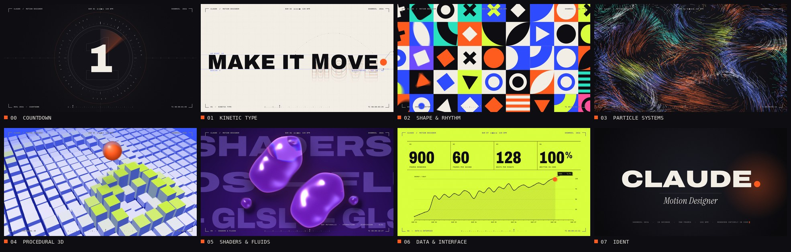

# SHOWREEL 2026 — Claude, Motion Designer



**▶ [`showreel.mp4`](showreel.mp4)** · 15 s · 1920×1080 · 60 fps · H.264 + AAC · original beat-synced soundtrack

One ember dot travels through eight motion-design disciplines in **32 beats** — at 128 BPM that is
exactly 15.000 seconds. Every section is one bar, every transition is a match cut on the dot, every
cut lands on a beat, and every pixel and every audio sample is generated by code: no footage, no
samples, no stock assets, no keyframes in an editor.

## The edit

| Bar | Time | Section | What happens | Craft on show |
|:-:|---|---|---|---|
| 0 | 0.00 – 1.88 s | **Countdown** | A film-leader dial counts 3 · 2 · 1 on the beat, swells, then implodes into the dot | conic radar sweep, numerals that inflate in weight, anticipation on a back-in curve |
| 1 | 1.88 – 3.75 s | **Kinetic type** | Circle wipe on the drop. The dot becomes a bouncing ball; each impact pumps a word from hairline to black and springs an echo stack; it lands as the full stop | per-letter variable-font weight ripple (100 → 900), squash & stretch, an After Effects-style motion path with keyframes and handles |
| 2 | 3.75 – 5.63 s | **Shape & rhythm** | We dive through the full stop and pull out of a Bauhaus grid: radial ripple, sweep, card-flip wave, ripple, then the grid condenses to dots | four different wave choreographies, custom bézier easing, morphs |
| 3 | 5.63 – 7.50 s | **Particle systems** | 10,800 particles burst from the dots, ride a curl-noise vortex, write *flow*, and implode back into one point | seeded fixed-step simulation that can be sampled at any time, streak trails, light sweep |
| 4 | 7.50 – 9.38 s | **Procedural 3D** | The dot is now a sphere; the camera tilts down with it onto a 23 × 23 cloner field, every bounce sends a shockwave ring, the last one launches it into the lens | hand-rolled perspective camera, painter's algorithm, coloured shading, fog, contact shadows |
| 5 | 9.38 – 11.25 s | **Shaders & fluids** | Inside the sphere: the ember melts into liquid glass that splits, merges and refracts the type behind it | WebGL2 metaball field with hemispherical normals, refraction with chromatic dispersion, fresnel, thin-film iridescence |
| 6 | 11.25 – 13.13 s | **Data & interface** | Slot-machine counters land on the reel's own specs while the dot draws an energy curve of the edit, one point per beat, then the signal tears apart | odometer reels, Catmull-Rom chart with live tooltip, RGB split, slice displacement, block noise |
| 7 | 13.13 – 15.00 s | **Ident** | Hard cut. The name rises in a hairline weight, the dot drops in as the full stop and its impact pumps the wordmark to black | the opening move again, closing the loop |

The soundtrack follows the same grid: countdown blips and a riser, the drop, plucks pitched to each
ball impact, tick cascades for the grid ripples, sparkle arps for the particles, thuds for the
sphere, an underwater low-pass while we are inside the liquid, slot-reel ticks, a beat-repeat glitch
with a breath of silence, then the final hit and a logo chime.

## How it is made

| | |
|---|---|
| **Renderer** | [`showreel/index.html`](showreel/index.html) + [`src/`](showreel/src) — a canvas 2D / WebGL2 compositor. Every frame is a pure function of time, so frames can render in any order. |
| **Motion blur** | Each output frame averages 10 sub-frames across a 216° shutter (up to 40 on the fastest wipes and zooms), accumulated exactly in packed 16-bit lanes. Shutter samples never straddle a hard cut, so cuts stay crisp. |
| **Finishing** | Film grain is added per frame after the blur; the viewfinder HUD (section labels, metronome, beat ruler, timecode) is drawn in `difference` blend so it reads on every background. |
| **Offline render** | [`render.mjs`](showreel/render.mjs) serves the page, drives four headless Chromium workers in parallel through Playwright, writes PNG frames and encodes with ffmpeg (libx264, BT.709-tagged, AAC). |
| **Soundtrack** | [`audio/soundtrack.py`](showreel/audio/soundtrack.py) — numpy/scipy synthesis: kick, clap, hats, supersaw pads, bass, FM bells, plucks, risers, a convolution reverb from a generated impulse response, sidechain ducking, a look-ahead limiter. About −13 LUFS. |

## Rebuild it

```bash
cd showreel
pip install numpy scipy imageio-ffmpeg      # imageio-ffmpeg ships an ffmpeg with libx264
npm install                                 # playwright (uses an installed Chromium)
npm run render                              # soundtrack + 900 frames + encode → ../showreel.mp4

# quick look at any moment, without motion blur:
node render.mjs --beats 6.5,20.6 --samples 1        # → out/stills/
```

A full render takes about 15 minutes on 4 CPU cores (software WebGL).

## Credits

Typefaces, all under the SIL Open Font License 1.1 (licence texts in [`showreel/fonts/`](showreel/fonts)):
[Archivo](https://github.com/Omnibus-Type/Archivo) by Omnibus-Type ·
[Instrument Serif](https://github.com/Instrument/instrument-serif) by Instrument ·
[JetBrains Mono](https://github.com/JetBrains/JetBrainsMono) by JetBrains.

Everything else — animation, simulation, shading, sound — is written from scratch in this repository.
