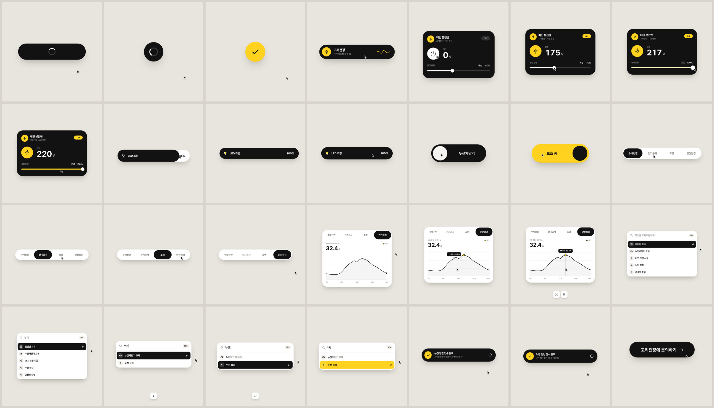

# 고려전장 — UI 모션그래픽



**▶ [`goryeo.mp4`](../goryeo.mp4)** · 14초 무한 루프 · 1440×1440 · 60fps · H.264 + AAC · 120 BPM 원곡

전기기능장이 운영하는 **고려전장**을 소개하는 UI 모션그래픽입니다. 하나의 도형이 끊기지 않고
열두 가지 UI 상태로 모프합니다. 커서가 실제로 클릭하고 드래그해서 모든 변화를 일으키고,
7마디 28박 동안 박마다 무언가가 일어납니다. 마지막 프레임은 첫 프레임으로 이어지며, 커서
위치와 속도까지 맞아떨어집니다.

## 비트 그리드 (120 BPM · 1박 = 0.5초)

| 마디 | 박 | 상태 | 일어나는 일 |
|:-:|:-:|---|---|
| 1 호출 | 0 · 1 · 2 · 3 | 버튼 → 로더 → 체크 → 다이내믹 아일랜드 | `고려전장에 문의하기` 클릭, 스피너, 노란 체크, 체크가 아일랜드 아바타가 됨 · `전기기능장 출동 중` |
| 2 전원 | 4 · 5 · 6 · 7 | 분전반 카드 (플레이어) | 아일랜드를 클릭하면 아래로 펼쳐짐, ⏻ → ⚡ 모프와 0 → 220 V, 공정 진행바를 잡고 끝까지 스크럽 (착공 · 배선 · 결선 · 검사 · **준공**) |
| 3 조절 | 8 · 9 · 10 · 11 | 밝기 슬라이더 → 토글 | 진행바가 `LED 조명` 디머로 바뀜, 최대치를 넘겨 끌면 고무줄처럼 늘어나고 놓으면 놓은 자리에서 스프링으로 복귀, 전구가 노랗게 켜짐 |
| 4 안전 | 12 · 13 · 14 · 15 | 누전차단기 토글 → 서비스 탭 | 다운비트에 ON(노란색이 노브를 따라 채워짐), 노브가 리퀴드 탭 인디케이터가 됨: 수배전반 · 전기공사 · 조명 |
| 5 실적 | 16 · 17 · 18 · 19 | 탭 → 차트 | 안전점검 탭이 아래로 열려 부하 측정 차트가 됨, 선이 스스로 그려지고 피크가 찍힘, 툴팁이 시간별 데이터 점에 스냅 |
| 6 검색 | 20 · 21 · 22 · 23 | ⌘K 팔레트 | ⌘K, `ㄴ → 누 → 눚 → 누저 → 누전` 한글 조합 입력, 5개 → 2개 필터, ↓ |
| 7 연결 | 24 · 25 · 26 · 27 | 토스트 → 버튼 | ⏎ 하이라이트가 노랗게, 하이라이트가 토스트의 체크 아이콘으로 줄어듦 · `누전 점검 접수 완료`, `고려전장 · 전기기능장 직접 시공`, 다시 버튼으로 |

화면 속 서비스 목록과 차트 수치는 **예시**입니다. 차트는 실적이 아니라 하루 부하 측정 데모입니다.
실제 연락처, 서비스, 수치가 정해지면 `index.html`의 `TABS`, `ROWS`, `LOAD`와 문구만 바꾸면 됩니다.

## 만든 방식

| | |
|---|---|
| **한 도형** | 모든 상태는 `#shape` 하나의 크기, 반경, 색 목표값입니다. 안의 내용은 상태마다 따로 등장/퇴장 타이밍을 가지고 짧은 블러로 교체되어, 모프 중에도 글자가 겹치지 않습니다. |
| **순수 함수** | `seek(t)`가 매 프레임 모든 스타일을 처음부터 계산합니다. CSS 트랜지션, 타이머, 프레임 사이의 상태가 없습니다. |
| **스프링** | 닫힌 형태의 스텝 응답입니다. 목표가 여러 번 바뀌는 값은 변화마다 스프링 하나씩을 더한 합이고, 주기적으로 평가하므로(이전 루프의 꼬리 포함) `f(T) = f(0)`이 값과 속도 모두에서 성립합니다. 감쇠비는 0.8 안팎이라 오버슈트는 2% 미만입니다. |
| **리퀴드 노브** | 노브의 양쪽 가장자리가 서로 다른 스프링을 탑니다. 진행 방향의 가장자리가 앞서 가서 늘어납니다. 토글 노브가 탭 인디케이터, 팔레트 하이라이트, 토스트 아이콘으로 이어집니다. 탭과 팔레트 글자는 노브가 덮은 부분만 정확히 반전됩니다. |
| **직접 조작** | 드래그하는 동안의 값은 커서 위치로 계산하고, 놓으면 그 자리와 그 속도에서 스프링으로 돌아갑니다. |
| **카메라** | 상태마다 도형이 화면을 채우도록 줌과 팬을 합니다. 카메라가 스케일하는 요소에는 `will-change`를 쓰지 않아 글자가 선명합니다. |
| **음악** | [`audio/music.py`](audio/music.py): numpy 합성 원곡입니다 (C장조, Fmaj7 · G6 · Em7 · Am7 · Dm9 · G7sus4 · Cadd9). 이벤트를 세 루프에 걸쳐 렌더링하고 가운데 루프만 남겨서 리버브 꼬리까지 이음매 없이 이어집니다. |
| **비트 분석** | [`audio/analyze.py`](audio/analyze.py): 스펙트럴 플럭스 자기상관으로 템포(120.00 BPM)를 구하고, 박 주기 콤 필터와 킥의 저역 상승으로 위상을, 5ms 창으로 밀리초 단위 보정(첫 박 −1.4 ms)을, 코드와 베이스 루트 변화로 다운비트를 찾습니다. 화면의 모든 이벤트가 이 측정 그리드 위에 놓입니다. |
| **UI 사운드** | [`audio/mix.py`](audio/mix.py): 클릭, 차단기 딸깍, 60Hz 전원 험, 키 입력, 차임을 합성하고, 각 소리의 피크를 측정해서 그 피크가 정확히 큐에 오도록 배치합니다. 큐 목록은 페이지가 직접 내보냅니다. |
| **렌더** | [`render.mjs`](render.mjs): Playwright로 프레임당 서브프레임 4장(270° 셔터)을 찍고 ffmpeg `tmix`로 섞어 60fps 모션 블러를 만듭니다. 4개 워커가 병렬로 렌더링하며 약 3분 걸립니다. |

## 다시 만들기

```bash
cd goryeo
pip install numpy scipy
npm install                       # playwright, pretendard
npm run render                    # 음악 → 비트 분석 → 큐 → 믹스 → 840프레임 → ../goryeo.mp4

npm run stills                    # 비트마다 한 장 → out/contact.png (전체 렌더 전 점검용)
node render.mjs --times 6.05      # 특정 시각 스틸
```

`index.html`을 브라우저에서 바로 열면 실시간으로 재생됩니다. 클릭하면 소리와 함께 처음부터 재생되고,
`?t=6.05`를 붙이면 그 순간에 멈춥니다.

## 크레딧

서체: [Pretendard](https://github.com/orioncactus/pretendard) by Kil Hyung-jin, SIL Open Font License 1.1
([`fonts/OFL-Pretendard.txt`](fonts/OFL-Pretendard.txt)). Geist에는 한글이 없어 Pretendard 한 가지로 통일했습니다.
그 밖의 애니메이션, 아이콘, 음악, 효과음은 모두 이 저장소의 코드로 만들었습니다.
